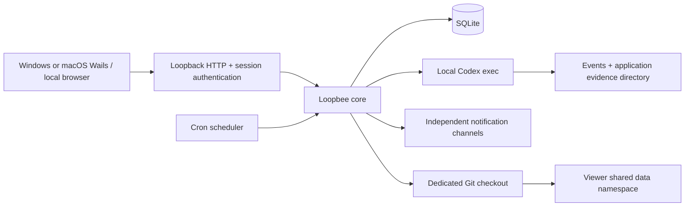

# Architecture

The original overview did not include its referenced subpages. This directory documents contracts derived from the overview, HTML prototype, and actual implementation. Scope differences are collected in contracts.md. Static prototype sample data is not seeded into the application.



## Directories and responsibilities

- `cmd/loopbee`: lifecycle, HTTP listener, and platform shell. The default port is random. Windows and macOS use Wails by default and retain nogui build/runtime entry points; Linux uses nogui. Windows WebView2 configuration lives in `webview/` under the data directory, isolating sessions across data directories. Camera, microphone, location, and similar web permissions are explicitly denied.
- `internal/core`: models, SQLite, scheduler, Runner, notifications, archives, sync, and system keychain. No HTTP or DOM dependencies.
- `internal/httpapi`: request-size limits, Host/Origin validation, session authentication, routes, and embedded assets.
- `internal/ui/web`: native ES modules, translation tables keyed by English text, and prototype CSS. No production npm dependencies or bundler.

The default data directory is `os.UserConfigDir()/loopbee`: `~/Library/Application Support/loopbee` on macOS, the user's AppData configuration directory on Windows, and Go's XDG configuration location on Linux. Override it with `-data`; it does not depend on all-docs.

```text
loopbee/
  instance.lock         # OS file lock, released automatically on process exit
  loopbee.db            # SQLite WAL
  loopbee.db-wal / -shm
  launch-url.txt        # Sensitive authentication link for this launch
  runs/<run-id>/*.txt   # Output for each round and step
  team/.git/            # Dedicated application checkout
```

## Concurrency and recovery

SQLite access is serialized through a single connection. The application mutex protects settings, Run claims, resource locks, and human gate channels. Each Run has its own bounded context. After HTTP shutdown, the core context is cancelled and background work is awaited. Non-Windows platforms use separate process groups and terminate the entire group; Windows uses hidden processes and `taskkill /T /F`.

At startup, queued/running/waiting Runs become interrupted; steps that may already have caused side effects are never automatically replayed. Pending/retryable deliveries become unknown. Each gate decision is consumed once and requires a note. Runs record complete Loop snapshots so later edits do not alter definitions already executed.

## Trust boundaries

Authentication cookies use HttpOnly / SameSite Strict. Each launch generates a random token exchanged only through the local launch URL. Non-loopback listeners, Host confusion, and cross-Origin/Fetch-Site writes are prohibited. JSON is limited to 1 MiB, with unknown fields and multiple top-level values rejected. ZIP uploads are limited to 32 MiB and extracted contents to 128 MiB; extra paths and symbolic links are prohibited.

The UI HTML-escapes external text, and CSP disallows inline scripts. Artifact downloads require registered names and manifest entries, never arbitrary local paths. Secret references are separate from business records; plaintext persistence is refused when the system keychain is unavailable.

Verification commands in Loop definitions are explicitly authorized local programs and **do not run inside the Codex sandbox**. They use argv only, without shell interpolation. An allowlisted program may still access other files. Do not enable untrusted imported definitions without review. Codex read/write boundaries come from the CLI sandbox, not the prompt.
